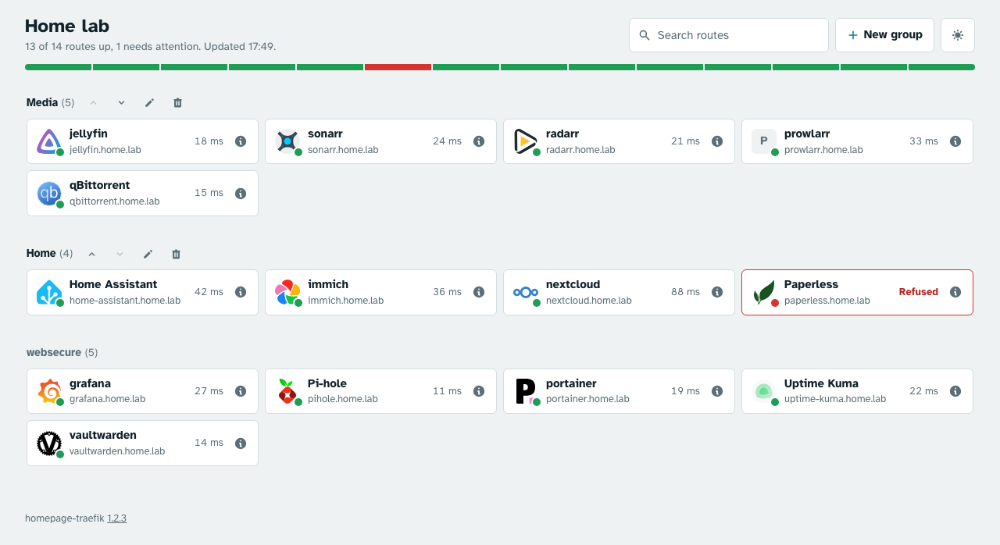

# homepage-traefik

A small homepage that lists every route your Traefik is serving, with a live status for each one.

- **Nothing to configure per service.** It reads the routers from the Traefik API, so a new service shows up within one poll.
- **Every provider.** It reads routers defined anywhere: Docker labels, the file provider (a `providers.yaml` or other dynamic config files), Kubernetes, Consul and the rest. See [Where routes come from](https://gregoryduckworth.github.io/homepage-traefik/routes).
- **Health checks.** Each route is checked from the server, and failures are explained in plain words.
- **Your layout.** Rename routes, set icons, hide the ones you don't need and drag them into groups. Everyone who opens the page sees the same layout.
- **Lightweight.** A single Node.js process with no runtime dependencies.



## Quick start

The example `docker-compose.yml` starts Traefik, the homepage and a `whoami` demo service:

```sh
mkdir config
docker compose up -d
```

Open <http://home.localhost>. You should see `home.localhost` and `whoami.localhost` listed. On Linux, if your user's UID isn't 1000, run `sudo chown 1000 config` first (see [Saved settings](https://gregoryduckworth.github.io/homepage-traefik/saved-settings)).

## Adding it to an existing Traefik

1. Enable the Traefik API, either with `--api.insecure=true` (serves it on port 8080 inside the Docker network) or with `--api=true` and a router for `api@internal` that the homepage can reach. That router can use a `basicAuth` middleware: see [A Traefik API behind basic auth](https://gregoryduckworth.github.io/homepage-traefik/getting-started#a-traefik-api-behind-basic-auth).
2. Run the homepage on the same Docker network as Traefik, using the pre-built image for `amd64` and `arm64`:

```yaml
services:
  homepage:
    image: ghcr.io/gregoryduckworth/homepage-traefik:latest
    environment:
      TRAEFIK_API_URL: http://traefik:8080
      HOMEPAGE_TITLE: Home lab
    volumes:
      - ./config:/app/config
    labels:
      - traefik.enable=true
      - traefik.http.routers.homepage.rule=Host(`home.example.com`)
      - traefik.http.services.homepage.loadbalancer.server.port=3000
```

## Documentation

The full documentation is at **<https://gregoryduckworth.github.io/homepage-traefik/>**:

- [Getting started](https://gregoryduckworth.github.io/homepage-traefik/getting-started): the quick start, adding it to an existing Traefik, a Traefik API behind basic auth, image tags and checking an image's provenance
- [Where routes come from](https://gregoryduckworth.github.io/homepage-traefik/routes): which routers are listed, and how each is named, linked and grouped
- [Configuration](https://gregoryduckworth.github.io/homepage-traefik/configuration): every environment variable
- [Health checks](https://gregoryduckworth.github.io/homepage-traefik/health-checks): what each status means, changing how a route is checked, and fixing checks that time out or distrust your certificates
- [Customising the page](https://gregoryduckworth.github.io/homepage-traefik/customising): names, icons, groups, hiding routes, and sharing the page read-only
- [Saved settings](https://gregoryduckworth.github.io/homepage-traefik/saved-settings): the config folder, editing `homepage.json` by hand, and disk writes on SD cards
- [API](https://gregoryduckworth.github.io/homepage-traefik/api): the HTTP endpoints the page uses
- [Development](https://gregoryduckworth.github.io/homepage-traefik/development): running it locally, the tests, the docs and releasing

The site is built from the Markdown in [`docs/`](docs), so you can also read it here on GitHub.

## License

[MIT](LICENSE). The bundled font in `public/fonts` has its own licence, the SIL Open Font License, in [`public/fonts/OFL.txt`](public/fonts/OFL.txt).
